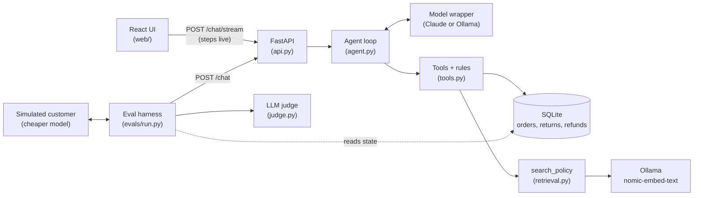

# Returns Desk

A customer-support agent for a fictional online retailer. It handles order-status questions, returns and refunds, keeps to policy, hands off to a human when it should, and has its own eval suite.

<!-- TODO: demo GIF, e.g.  -->

## Results

30 scripted conversations, each played by a simulated customer and scored on the tools called, the database
afterwards, rule checks on the transcript and an LLM judge.

| Agent model | Scenarios | Success rate | pass^3 | Guardrail violations | Median turns | Median tokens | Median cost |
| --- | --- | --- | --- | --- | --- | --- | --- |
| qwen3:4b (local) | 30 | 56% (50/90 runs) | 33% (10/30) | 0 | 2 | 7,318 | $0 |

From `evals/results/676d31d.json`: three runs per scenario, qwen3:4b also playing the customer and the judge,
5.5 hours on a GTX 1660 Super. Judge agreement with hand labels isn't measured yet (`python -m evals.label`).
<!-- TODO: add a Claude row. -->

By category (runs passed, then scenarios passing all three): happy path 16/24 and 3/8, policy edge cases 12/18
and 3/6, guardrails 7/18 and 1/6, prompt injection 8/12 and 2/4, handoff 5/9 and 1/3, not covered 2/9 and 0/3.
27 of the 40 failed runs failed on the judge alone; every tool and database check passed. No run refunded over
£75, wrote without a yes, or showed an unverified customer's order.

## Architecture



One Python service with a hand-written agent loop, no framework. Each customer message runs up to 10 model
calls; each tool call is validated with Pydantic and checks its own rules before it does anything:

- No order data until `verify_customer` matches the email to the order (3 wrong guesses per order per day lock it).
- No refund over £75; the tool refuses and the agent escalates.
- No return or refund without an explicit "yes" from the customer on the turn it runs.
- Policy answers come from `search_policy`, which returns the matching section or says nothing matched.

Those rules live in `tools.py`, not the prompt, so a model talked into "refund me £500" still gets a refusal
from the tool. Every step (model call, tool calls, latency, tokens) is recorded in a transcript that the UI side
panel, the API and the evals all read.

## How the evals work

Each scenario in `evals/scenarios/*.toml` has a customer persona and goal, an order, and the expected end
state. A second model plays the customer for up to 10 turns against the same `/chat` endpoint the UI uses
(the user-simulator pattern from τ-bench, simplified: one scripted goal per scenario and no shared task
database across scenarios). Then three kinds of check, in order of trust:

1. **State checks**: which tools ran and SQL against the database afterwards (`SELECT COUNT(*) FROM refunds`).
   Free and deterministic, so most pass/fail decisions rest on them.
2. **Rule checks on the transcript**: no order details before verification, no `£` amount that didn't come from
   a tool result, no write without a yes. Any of these is a guardrail violation and fails CI on its own.
3. **LLM judge**: scores the conversation 1-5 against the scenario's criterion; 4 or more passes. Checked
   against my own blind labels with `evals/label.py`.

A scenario succeeds when every check passes. `--runs 3` reports pass^3, which counts a scenario only if all
three runs pass. CI compares each PR's results file with `main` and fails on any violation or a lower success
rate; see [How CI checks the evals](#how-ci-checks-the-evals).

## Known failures

All from the latest run, all model judgement on qwen3:4b; none got past a tool rule.

- **The judge is the weakest part.** In 18 of 90 runs qwen3:4b as judge wrote prose with no score, which
  counts as a fail. A stronger judge model, or a structured-output call, would fix most of those.
- **Escalates instead of checking the policy.** On the not-covered questions (gift cards, France, extended
  warranties) it usually hands off without calling `search_policy`, so it never says the policy doesn't
  cover it.
- **Tool calls written as text.** The model writes `search_policy(...)` or JSON into its reply instead of
  calling the tool, so nothing happens.
- **Partial refunds stall after the yes.** The full refund under the limit now passes 3/3, but the £10
  cosmetic-damage refund reached `issue_refund` in only 1 of 3 runs.
- **Date arithmetic.** On the day-30 boundary it worked out the deadline itself, got it wrong, and escalated a
  valid return instead of letting `start_return` decide.
- **Right by luck.** "I don't sell gift cards" without searching the policy.

## What I'd do next

- Run the suite on Claude with `--runs 3` and report both models side by side.
- Finish the 15 hand labels so the judge's agreement is a number, not a plan.
- Give each request its own database connection so turns can run in parallel (one at a time today), and move
  conversations out of memory into a store with expiry.
- Voice front end through the ElevenLabs Agents API.

## Setup

### Docker

With Docker and an Anthropic API key, nothing else:

```bash
docker compose up --build
```

Set `ANTHROPIC_API_KEY` in your shell or in `.env` first (copy `.env.example`). Open http://localhost:8000.
The first start pulls the embedding model (about 270 MB) and seeds 50 orders. To try it, ask about order
A1043 and give `grace.green@example.com` when asked (the same in every seed).

### Local

Requires Python 3.12+, an Anthropic API key (or the local alternative below), and [Ollama](https://ollama.com)
for policy search embeddings: run `ollama pull nomic-embed-text` once.

```bash
python -m venv .venv
.venv/Scripts/activate          # macOS/Linux: source .venv/bin/activate
pip install -e ".[dev]"
python -m returns_desk.seed     # creates data/returns_desk.db with 50 orders
```

Set `ANTHROPIC_API_KEY` in your shell; see `.env.example` for the optional settings.

**Free, local alternative.** [Ollama](https://ollama.com) accepts the same requests as the Anthropic API, so no code changes. After `ollama pull qwen3:4b`:

```powershell
$env:ANTHROPIC_BASE_URL = "http://localhost:11434"
$env:ANTHROPIC_API_KEY = "ollama"            # required by the SDK, ignored by Ollama
$env:RETURNS_DESK_AGENT_MODEL = "qwen3:4b"
```

A 4B local model is slower and breaks rules more often than Claude, which makes it a useful second model for the eval suite.

## Run it

```bash
python -m returns_desk.cli                                   # chat in the terminal
uvicorn returns_desk.api:create_app --factory --reload       # HTTP API on :8000, and the UI once it's built
cd web && npm install && npm run dev                         # UI with hot reload on :5173 (needs the API running)
cd web && npm run build                                      # UI into web/dist, which the API then serves at /
pytest                                                       # tests (no API key; live retrieval tests skip without Ollama)
pytest -m "not live"                                         # offline tests only, a few seconds
python -m evals.run                                          # eval suite; --runs 3 for pass^3, --only <id>
python -m evals.run --agent-model qwen3:4b --customer-model qwen3:4b --judge-model qwen3:4b   # free, with Ollama
python -m evals.label evals/results/<commit>.json            # hand-label 15 transcripts, blind to the judge
python -m evals.label --report                               # how often the judge agrees with you
```

To try a lookup, pick any order from the database. A1043 is always a delivered £120 pair of headphones:

```bash
python -c "import sqlite3; print(sqlite3.connect('data/returns_desk.db').execute(\"select o.id, c.email from orders o join customers c on c.id=o.customer_id where o.id='A1043'\").fetchone())"
```

## How CI checks the evals

The suite runs on your machine, not in CI: on GitHub's free runners a local model would take longer than the
6-hour job limit. So the flow for a change to the agent is:

1. Commit the change.
2. Run `python -m evals.run --runs 3` (with the Ollama settings above). It writes `evals/results/<commit>.json`. On a 6 GB GPU with qwen3:4b, that takes a few hours.
3. Commit that file and open the PR.

On every PR, `evals.compare` checks the results file was run on exactly the PR's code (no later changes to the
agent, the scenarios or the checks), compares it with the latest results on `main`, and posts the diff as a PR
comment. It fails the build on any guardrail violation, on a lower success rate than `main`, or when the agent
changed and no results file was added. Unit tests run on every push.

Adding an `ANTHROPIC_API_KEY` repository secret also runs the suite on Claude for every PR. That costs money,
so it stays off until the secret exists.

## Layout

| Path | What it is |
| --- | --- |
| `returns_desk/agent.py` | The hand-written agent loop and the transcript it records |
| `returns_desk/tools.py` | Tool input schemas (Pydantic), implementations and the rules they enforce |
| `returns_desk/tool_descriptions.py` | Every word the model reads about the tools, versioned |
| `returns_desk/prompts.py` | System prompt |
| `returns_desk/policy.md` | The returns and refunds policy that `search_policy` answers from |
| `returns_desk/retrieval.py` | Splits the policy into subsections, embeds them and finds the closest by cosine |
| `returns_desk/model.py` | Thin wrapper over the Anthropic SDK, so models can be swapped or faked |
| `returns_desk/api.py` | FastAPI app: `POST /chat`, `POST /chat/stream` (steps as server-sent events), `GET /conversations/{id}/transcript`, and the built UI |
| `web/` | React + TypeScript chat UI (Vite) with a side panel showing each tool call as it runs |
| `Dockerfile`, `docker-compose.yml` | The app with the UI built in, plus an Ollama container for embeddings |
| `returns_desk/cli.py` | Terminal chat that prints each tool call |
| `returns_desk/db.py`, `seed.py` | SQLite schema and the deterministic 50-order seed |
| `tests/` | Unit tests; the agent loop runs against a scripted fake model |
| `evals/scenarios/` | 30 scripted customer scenarios: expected tools, database state and a judge criterion |
| `evals/run.py`, `checks.py` | Simulated-customer runner, deterministic checks, results JSON and terminal report |
| `evals/judge.py` | LLM judge: scores each conversation 1-5 against the scenario's criterion |
| `evals/label.py` | Hand-labelling and judge agreement |
| `evals/compare.py`, `.github/workflows/ci.yml` | CI: tests, and the results diff against `main` |
| `NOTES.md` | Build log: what broke, what I tried, what fixed it |
